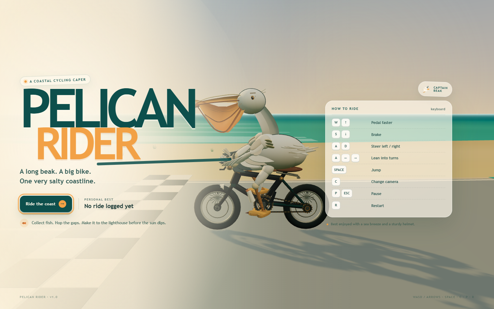
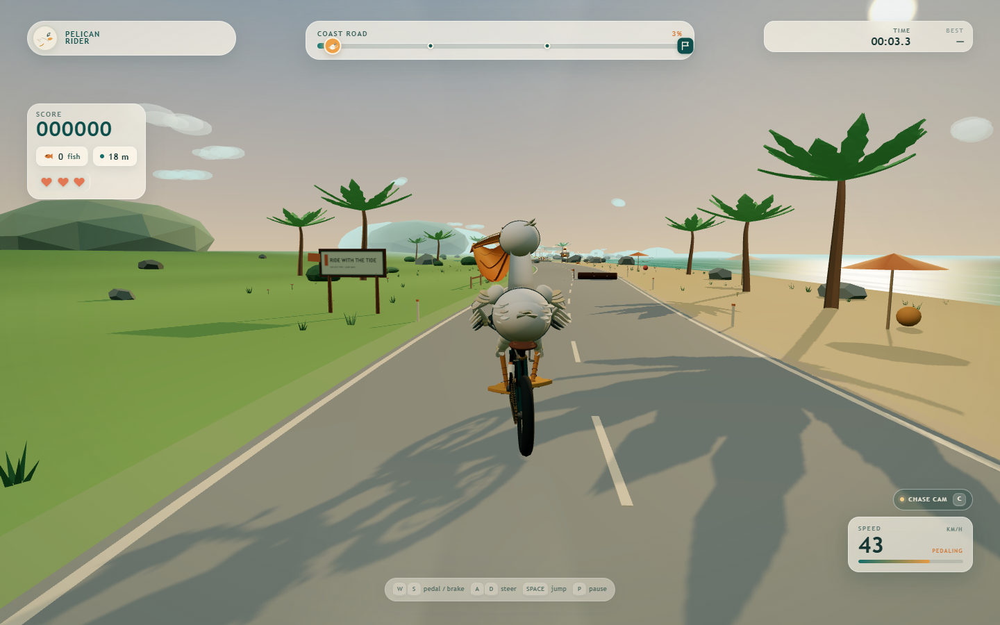
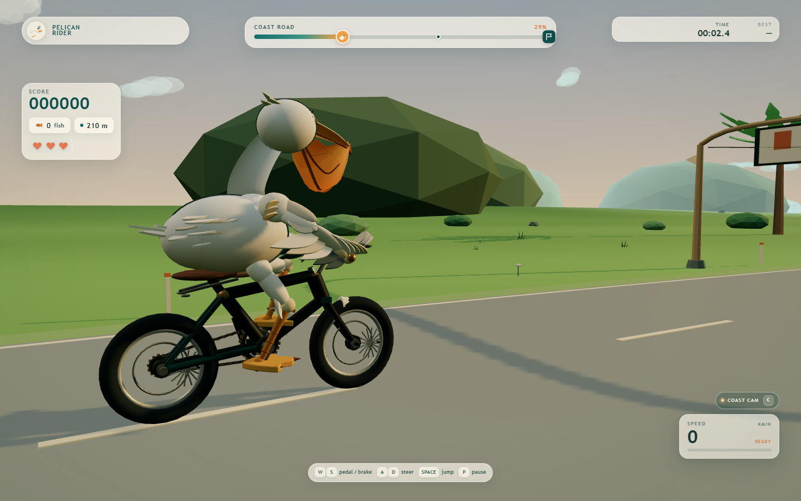

# Pelican Rider

A complete, playable 3D browser game about a pelican taking a mechanically
coherent bicycle for a slightly overconfident ride along a coastal cycle path.



## Local Development

Requirements: Node.js 20.19+ (`.nvmrc` pins the Netlify runtime to Node 22),
npm, and a WebGL2-capable desktop browser.

```bash
# Reproducible install from the committed package-lock.json
npm ci

# Start the Vite dev server
npm run dev
```

Vite prints the local URL (by default `http://127.0.0.1:5173/`).

```bash
npm run typecheck   # strict TypeScript check
npm run build       # type check + production bundle in dist/
npm run preview     # serve the production build (http://127.0.0.1:4173/)
```

The game is a single static page. The production build is entirely contained
in `dist/` and needs no backend, API routes, or environment variables.

### Social preview assets

- `/favicon.svg` — browser icon.
- `/og-image.jpg` — 1200×630 Open Graph/Twitter preview image.
- The canonical URL and Open Graph image URL use the Netlify-provided `URL`
  (or `DEPLOY_PRIME_URL` on deploy previews) at build time. Local builds fall
  back to `http://localhost:5173`; Netlify production builds get the real
  HTTPS site URL automatically.
- Touch-first devices see a friendly keyboard-required gate. A physical
  keyboard can still be used via **I have a keyboard**.

## How to play

Ride from the PELICAN COAST starting line to the lighthouse at Pelican Point.
Collect floating fish, hop the broken-road gaps, dodge rocks and driftwood,
and pass both checkpoints before the three hearts run out.

| Input | Action |
| --- | --- |
| `W` / `↑` | Pedal / accelerate |
| `S` / `↓` | Brake |
| `A` / `←`, `D` / `→` | Steer and lean |
| `Space` | Jump |
| `C` | Cycle camera (chase → close → coast) |
| `P` / `Esc` | Pause / resume |
| `R` | Restart the ride |

- **Fish** are worth 100 points and chain into a combo (up to ×2.5).
- Fish hovering above the road need a small jump.
- Checkpoints refill one heart and become your respawn point.
- A gap or an off-trail tumble costs a heart and sends you back to the last
  checkpoint. Three crashes end the run. The lighthouse finish awards
  completion, health, fish-collection, and time bonuses.
- The best score and best completion time persist in `localStorage` under
  `pelican-rider.best.v1`.

## Screenshots





## What is implemented

### Pelican and bicycle

- A fully procedural pelican: tapered body/neck/head, long flattened bill,
  large orange gular pouch with folds and rim, eyes with irises and blink,
  crest, two layered wings, webbed feet, and a tail fan.
- A procedural bicycle with spoked wheels, tyres, hubs, axles, a coherent
  frame triangle, fork, steering head, handlebars, saddle, seat post,
  crankset, chainring, chain links, rear cog, and two pedals.
- Analytic two-bone IK attaches the wings to the moving handlebar grips and
  the feet to the rotating pedal platforms. The targets are read from the
  actual bicycle anchors every frame, so steering, pedalling, leaning, and
  suspension motion all remain mechanically connected.
- Wheels are driven by travelled distance; the cranks and pedals share the
  same distance-driven phase. The front assembly turns with steering, and the
  wings follow those moving grips.
- Body, neck, head, tail, wings, and legs have speed-, steering-, jump-, and
  crash-driven secondary motion. The rider leans into turns and keeps both
  feet and both wingtips attached throughout jumps and crashes.

### World and presentation

- A seeded, deterministic coastal course: winding road, grass shoulders,
  inland hills, a narrow beach, an animated ocean with shoreline and offshore
  foam lines, islands, sailboats, gulls, clouds, and a low warm sun.
- Palms, rocks, bushes, grass tufts, wildflowers, fences, signs, parasols,
  beach towels, a beach ball, checkpoints, two bridges over tidal streams, two
  broken-road gaps, roadside warning flags/cones, a finish arch, and a
  lighthouse.
- Custom sky shader, fog, warm directional sunlight with shadows, hemisphere
  and fill lighting, and runtime-generated sign textures. No external 3D
  models, images, or audio assets are used.
- Instanced rendering for repeated scenery, fish, grass, flowers, and road
  furniture.
- Complete DOM UI: loading state, main menu, controls card, best score,
  countdown, HUD, speedometer, hearts, route progress, fish/distance readouts,
  camera label, gap/fish prompts, toasts, pause, results, and victory/game-over
  states.
- Share-ready document metadata (title, description, canonical URL, Open
  Graph/Twitter cards and a generated 1200×630 preview), a real SVG favicon,
  a JavaScript-disabled fallback, and a keyboard-required gate for touch-first
  devices.

### Gameplay

- Arcade bicycle physics with acceleration, braking, drag, speed-sensitive
  steering, lean, off-road speed limits, jump gravity, ground detection,
  suspension response, and wheel/pedal distance coupling.
- Obstacle OBB collisions, gap detection, boundary/off-road detection,
  checkpoint progression and healing, safe-point crash recovery, and fall
  respawns.
- Increasing obstacle density and paired obstacles later in the route.
- Keyboard-only control scheme with pause, restart, camera switching, and
  browser-local best-score persistence.
- A fixed 780 m course with two checkpoints, two bridges, two gaps, 88 fish,
  and a finish at z = 724.

## Architecture

```
src/
  main.ts                  bootstrap and fatal-error handling
  game/
    Game.ts                scene/game orchestration and state transitions
    GameLoop.ts            rAF loop and rolling frame statistics
    InputManager.ts        keyboard state and edge-triggered actions
    GameState.ts           phase, hearts, crashes, timer, result types
  character/
    Pelican.ts             procedural rig, meshes, and IK pose solver
    Bicycle.ts             mechanical bicycle rig and moving anchors
    RidingAnimation.ts     connects bicycle anchors to pelican IK
  physics/
    BicyclePhysics.ts      longitudinal/steering/jump model
    CollisionSystem.ts     obstacles, gaps, boundaries, checkpoints, finish
  gameplay/
    LevelManager.ts        deterministic seeded course layout
    Collectibles.ts        instanced floating fish and collection checks
    Obstacles.ts           log/rock/driftwood meshes and colliders
    ScoreManager.ts        combo scoring, finishing bonuses, localStorage
  scene/
    World.ts               terrain, road, bridges, gaps, props, landmarks
    Environment.ts         sky, ocean, foam, clouds, gulls, sailboats
    CameraController.ts    chase/close/coast and menu cameras
    Lighting.ts            sun, shadows, hemisphere, fill light
  ui/
    HUD.ts, MainMenu.ts, GameOver.ts, UIManager.ts, DeviceGate.ts
  utils/
    geometry.ts, ik.ts, math.ts, canvas.ts, ParticleSystem.ts
```

The rider hierarchy is:

```
playerRoot → leanGroup → bicycle.root
                       → pelican.root
```

World forward is local `+Z`. The bicycle anchors are converted into pelican
local space each frame, then the wing and leg IK is solved against them.

## Deployment

Deployment is designed for **GitHub + Netlify using the official Netlify Git
Integration**. There is intentionally no GitHub Actions workflow, no Netlify
Function, no API server, and no secret environment variable.

```text
git push origin main
        ↓
GitHub repository
        ↓
Netlify Git integration
        ↓
npm run build  →  dist/
        ↓
https://<site-name>.netlify.app
```

The repository uses **npm** (`package-lock.json` is committed; there is no
`pnpm-lock.yaml` or `yarn.lock`). The committed `netlify.toml` is:

```toml
[build]
  command = "npm run build"
  publish = "dist"

[build.environment]
  NODE_VERSION = "22"
```

- **Production branch:** `main`.
- **Build command:** `npm run build` (runs `tsc --noEmit` before Vite).
- **Publish directory:** `dist`.
- **Node runtime:** 22, also recorded in `.nvmrc`.
- **Deploy Previews:** enabled in the Netlify site settings for pull requests
  against `main`; Netlify builds them with the same configuration.
- **Failed builds:** Netlify does not promote a failed build to the live site.
- **Rollback:** use Netlify's deploy history to publish a previous successful
  deploy.
- **No SPA fallback:** Pelican Rider has no client-side router or History API
  routes, so no catch-all redirect is needed or configured.
- No environment variables, API keys, or tokens are required.

The assets use Vite's root-absolute `/assets/...` URLs, which is correct for a
Netlify site served at the domain root. `og:url`, `canonical`, and
`og:image` are made absolute at build time from Netlify's `URL` environment
variable (or `DEPLOY_PRIME_URL` for previews).

### Connect this local repository to GitHub

This workspace was initialized as a local Git repository with its changes
committed, but no GitHub remote is configured. Once the repository exists on
GitHub, run:

```bash
git remote add origin https://github.com/<github-account>/pelican-rider.git
git push -u origin main
```

With the GitHub CLI already authenticated:

```bash
gh repo create <github-account>/pelican-rider --public --source=. --remote=origin --push
```

Do not force-push and do not replace an existing unrelated remote.

## Netlify Setup

1. Push the local `main` branch to GitHub using the commands above.
2. Sign in to [Netlify](https://app.netlify.com/) with the GitHub account that
   owns the repository.
3. Choose **Add new site → Import an existing project → GitHub**, authorize the
   Netlify GitHub app, and select the Pelican Rider repository.
4. Accept the committed `netlify.toml` values. They should resolve to:
   - Production branch: `main`
   - Base directory: blank
   - Build command: `npm run build`
   - Publish directory: `dist`
   - Node: 22
   Do not add environment variables.
5. Click **Deploy site**. Netlify installs with npm from `package-lock.json`,
   runs the type check and Vite build, and publishes `dist`. HTTPS is configured
   automatically on the generated `.netlify.app` domain.
6. Open the deployed URL and verify the loading screen, menu, countdown, HUD,
   keyboard controls, and a full run.
7. Enable pull-request previews in **Site configuration → Build & deploy →
   Deploy Previews** (choose pull requests against the production branch).
8. To roll back, open **Deploys**, choose an earlier successful deploy, and use
   **Publish deploy**. Netlify keeps the deploy history.

No Netlify site was created by this workspace because no Netlify credential or
site target was available. The production URL should be copied from Netlify
after the first successful deploy; it is intentionally not fabricated here.

## Troubleshooting

### White screen after opening the site

Open DevTools → Console. Check that the deploy served `index.html` and that the
hashed `/assets/index-*.js` and CSS files returned HTTP 200. WebGL2 and hardware
acceleration must be enabled. If the loading overlay shows the bicycle-chain
error, check the browser console for the actual exception. Try a hard refresh
to rule out a stale asset.

### JavaScript or CSS returns 404

Confirm Netlify published `dist`, not the repository root. The Vite config uses
`base: '/'`, so the site must be served from the domain root rather than a
subdirectory. Do not open `dist/index.html` directly with `file://`; use
`npm run preview` or a static server. Check the Netlify deploy log for the
build output directory and inspect the generated `dist/index.html`.

### 3D models or textures fail to load

Pelican Rider has no external GLTF/GLB models, texture images, audio files,
fonts, or workers. Every model, sign texture, and particle is generated at
runtime. If the 3D canvas is missing, check for JavaScript errors, WebGL2
support, and the browser/GPU. There are no model or texture URLs to repair.

### Pointer Lock does not work

Pelican Rider does not use Pointer Lock or fullscreen APIs. All controls are
keyboard events on the window. Click the page or use **Continue** on the mobile
gate if focus is elsewhere. If keys do not register, make sure no browser
extension or password manager is capturing the key events.

### Node version mismatch

Netlify uses Node 22 from `netlify.toml`; locally use `.nvmrc` (`nvm use`).
Vite 7 requires Node 20.19+ or 22.12+. If Netlify reports an unsupported Node
version, clear the site's cached dependency directory and redeploy, or set
`NODE_VERSION = "22"` in the Netlify UI as well.

### Netlify build fails

Reproduce locally with the same steps:

```bash
npm ci
npm run typecheck
npm run build
```

Check that `package-lock.json` is committed and current, that no `pnpm-lock.yaml`
is expected, and that imports use exact case (Netlify's Linux filesystem is
case-sensitive). Inspect **Deploys → failed deploy → Deploy log** for the first
error. No API keys or environment variables should be required.

### Social preview is stale or missing

The Open Graph image is `/og-image.jpg` and becomes absolute from Netlify's
`URL`. After changing the custom domain or image, redeploy and refresh the
social platform's cache (for example with the platform's sharing debugger).
The canonical URL and `og:url` are generated at build time, not hardcoded.

### Mobile device shows a keyboard gate

This is intentional. Pelican Rider is keyboard-only; the gate prevents a
touch-only guest from entering a game that cannot be steered. Use a desktop or
laptop, or connect a physical keyboard and choose **I have a keyboard**.

## Verification and measured performance

The following was actually run on the development machine:

- `npm ci` — passed from the committed `package-lock.json` after a clean
  reinstall (23 packages; all lockfile entries resolve to registry.npmjs.org
  with no empty versions).
- `npm run typecheck` — passed with strict TypeScript.
- `npm run build` — passed; production bundle written to `dist/`.
- Production preview verified in Chrome at `http://127.0.0.1:4173/`: the two
  hashed JS/CSS assets, `/favicon.svg`, and `/og-image.jpg` all returned HTTP
  200; the menu loaded; the game started and responded to keyboard input;
  pause/resume worked; resizing to 1000×700 resized the canvas correctly; and a
  page reload returned to the menu without errors. There were no page errors,
  console errors, or failed asset requests.
- The mobile viewport (390×844, touch-first) showed the blocking keyboard gate;
  **I have a keyboard** dismissed it and exposed the menu. The gate had pointer
  events and was the topmost element while open.
- A Netlify-like production build with `URL` set was inspected: canonical and
  Open Graph/Twitter URLs were absolute, no `%SITE_URL%` placeholders remained,
  and no `localhost`/`127.0.0.1` URLs were present in `dist/index.html`.
- Automated Chrome playthroughs (temporary Playwright harness, not shipped)
  covered: menu → countdown → play, fish collection and HUD/toast, jump and
  landing, all three camera modes, pause/resume via `Esc` and buttons,
  checkpoint healing, successful gap jump, failed gap and checkpoint respawn,
  bridge crossing, obstacle crash and recovery, game over, restart, victory,
  result buttons, `R` restart, and localStorage best-score persistence.
  Final runs reported no page errors.
- The build prints Vite's standard >500 kB chunk warning because Three.js is
  bundled into the main chunk; the delivered JS is ~710 kB minified / ~186 kB
  gzip.

**Frame rate** (the game's own rolling `GameLoop` statistics, 1440×900 CSS
pixels, devicePixelRatio 1, headless Chrome on Windows, WebGL2 via ANGLE on
an NVIDIA GeForce RTX 3050):

| Measurement | Result |
| --- | --- |
| 1440×900, normal vsync | 59.95 FPS, 16.68 ms average, 16.8 ms p95 |
| 1920×1080, normal vsync | 59.95 FPS, 16.68 ms average, 16.9 ms p95 |
| 1440×900, vsync/frame-limit disabled | 135.7 FPS, 7.37 ms average, 8.5 ms p95 |

Renderer statistics during those runs were about 1,340 draw calls, 301k
triangles, 699 geometries, and 21 textures, including the shadow pass. The
default-vsync result is display-capped, so the uncapped run is the useful
headroom signal. These are measurements on this specific machine, not a
guarantee for integrated GPUs or 4K displays.

## Honest limitations

- Desktop keyboard only; there is no touch, gamepad, or audio layer.
- The course is one fixed, seeded 780 m level. Runs are deterministic; the
  difficulty ramps along the route, but there is no endless generation.
- Balance is represented by automatic lean, wobble, off-road instability, and
  the boundary crash rather than a separate manual balancing minigame.
- The visual style is deliberately low-poly/stylized. Feathers and the wings
  are constructed from simple procedural lobes and feather cards rather than
  sculpted meshes.
- Performance is measured on an RTX 3050. Integrated GPUs will likely need a
  lower resolution; there is no settings menu or dynamic quality scaler.
- A developer hook is intentionally left exposed at `window.__pelicanRider`
  (`startRun`, `skipCountdown`, `getDebugState`, `teleportNearFinish`) and
  `window.__pelicanGame` for inspection/performance checks. It does not affect
  normal play.
- The workspace root still contains unrelated image/SVG crops from earlier
  work; they are not loaded by the game. Only `index.html`, `src/`, `screens/`,
  and the config files are used by Vite.

## Asset and license notes

All game visuals are generated at runtime with Three.js geometry, Canvas 2D
textures, CSS, and inline SVG. No external 3D models, image assets, paid
assets, or network-hosted assets are required. Fonts are local system font
stacks.
